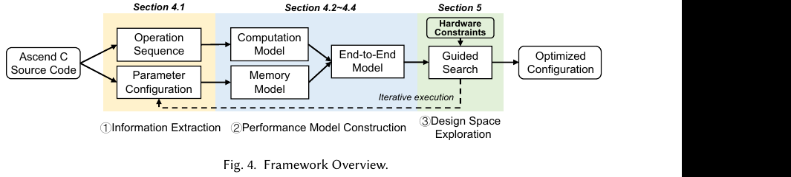

# MoE / NPU 算子与性能建模阅读笔记

范围：6 篇直接对应“NPU 卡上 MoE 场景计算通信融合算子的性能模型与优化”的论文，以及 3 篇 NPU kernel 优化/评测/建模基础论文。另将 TileSight 作为可迁移的 GPU 性能建模方法参考。笔记按论文正文中的章节、图表和表格定位。

## 1. HyperParallel-MoE: Efficient MoE Training on Ascend NPUs

**文件**：`Ascend-moe.pdf`；arXiv:2605.23764v2，2026；Zewen Jin 等。

### 背景与 Motivation

Ascend A3 的 AIC/Cube 与 AIV/Vector 是不同硬件队列，虽可跨队列 event 同步并共享 L2，但常规 MindSpore/MindFormers 执行将 Dispatch、GMM、SwiGLU、GMM、Combine 作为完整算子依次发射。作者 profiling 发现 EP 通信占关键路径约 17%，只有 61% 的通信时延被 Cube 计算隐藏；AIC MAC 利用率约 67%，关键路径上的 vector 运算也只有约 18%。因此问题不是单独加速 GEMM 或 All-to-All，而是把通信与计算切成可依赖、可调度的细粒度任务，同时不损害原有 GMM tiling 和 L2 locality（Sec. 2.1–2.3）。

### Insight → Design

- **Insight 1：通信任务可以像计算 tile 一样被生产、传递和唤醒。** Design：由 AIV 发起 one-sided `put_mem_signal`，先写远端数据、再增加目标侧 event counter；下游 task 仅在数据可见后被唤醒，减少 host/full-collective 同步（Sec. 4.1）。
- **Insight 2：切分边界必须同时满足数据依赖与算子内在约束。** Design：构建 operator dependency graph（ODG），用 SplitSpec 联合传播 Dispatch/GMM/SwiGLU 的切分；例如保留完整 expert 宽度以满足 GMM kernel 的 tiling 要求（Sec. 4.2）。
- **Insight 3：shape/并行配置可预知，运行时动态决策的成本可能抵消重叠收益。** Design：离线编译 static schedule configuration（SSC），写入 CTQ/VTQ 顺序、task 元数据和 event 阈值；运行时单次 kernel launch，由 AIC/AIV worker 静态调度并依赖事件推进（Sec. 4.3–4.4）。
- **Insight 4：在合法依赖顺序中重排任务可以改善通信热点和缓存复用。** Design：RATR 轮换目标 rank 以分散通信热点；反向的两个 GMM 分支按 expert locality 交错，提升 L2 复用（Sec. 4.5）。

### 实验设计与结果

模块实验使用 64 台 Ascend A3 device、DeepSeek-V3 风格 MoE-FFN，seq=4096、microbatch=2、hidden=7168、intermediate=2048、top-8、BF16，EP=4/8/16；标准完整算子串行执行、独占全核和 collective All-to-All 为 baseline。测 balanced routing 下 Dispatch→Combine 的 forward/backward，并以 sampled natural routing 测完整训练 step；先验证 BF16 正确性，SSC 编译不计入计时（Sec. 5.1–5.3）。

- Table 3 / Fig. 7：EP4 总时延由 44.2 ms 降至 29.6 ms（1.49×）；EP8 为 47.1→29.9 ms（1.58×）；EP16 为 48.9→31.1 ms（1.57×）。forward 提升 1.60–1.68×，backward 提升 1.44–1.53×。
- Fig. 8：sampled natural routing 的端到端训练 step 提升 1.08–1.09×，说明局部算子收益被 MoE 外部计算稀释。
- Fig. 9：A3 上 32k 行 SwiGLU+Add 的 tile interleaving 从 723.29 降至 588.38 μs（1.23×），L2 hit 从 5.20% 升至 25.44%；8k 情形有轻微变慢，显示细分/同步有固定成本。
- Fig. 10：动态调度约 2.36 μs/AIV task，静态约 0.1 μs；tile interleaving 在较大工作集更占优。

### 对本课题的启发与局限

这是最直接的 Ascend 参考：可借其 AIC/AIV 任务依赖图、跨队列事件、静态调度和 cache-aware 排序设计融合算子。它没有给出通用解析性能模型，主要是依赖 taskflow 的优化系统；balanced routing 是主要模块结果，natural routing 只给出 step-level 结果，缺少对 skew、shape 和组件贡献的系统分解。因此本课题可在其执行模型之上补充硬件校准的 latency model，并把路由分布作为显式输入变量（Sec. 6、8）。

## 2. UniEP: Efficient and Deterministic MoE Expert Parallelism

**文件**：`uniep.pdf`；arXiv:2604.19241v1，2026。

### 背景与 Motivation

MoE Expert Parallelism 的 All-to-All/All-Gather 常成为训练瓶颈。已有 multi-stream/CPU orchestration 和 micro-batch 方法带来流水气泡、SM 切分导致的计算尾波，以及转置 GroupGEMM accumulation tree 改变后的 BF16 非 bitwise 结果。All-to-All 与 All-Gather 的优劣又随稀疏度变化，迫使系统维护多套 kernel 和 heuristics（Sec. 1–2）。

### Insight → Design

- **Insight 1：GPU 内部 SM/block 可以自行承担计算、通信和转发任务调度。** Design：使用 persistent MegaKernel，每个 SM 常驻一个 block，worker 在 Comm/Comp/Relay 角色间按 task scoreboard 动态取任务；拆为 Dispatch+GroupedGEMM 与 GroupedGEMM+Combine 两段（Sec. 3）。
- **Insight 2：只保证 tile overlap 不足以保证浮点结果确定性，token 落位顺序会改变归约次序。** Design：本地 stable sort、all-gather rank/expert counts、prefix-sum 生成确定性全局 token mapping；Combine 等齐 top-k contribution 后按既定次序求和（Sec. 3.1–3.2）。
- **Insight 3：同 rank 多 expert 重复发送相同 token 浪费 NVLink。** Design：Relay worker 做跨 expert 本地 multicast；top-8、8-GPU 下理论平均只需发给 5.25 个 rank，约节省 34% 通信（Table 1）。
- **Insight 4：最优并行配置随模型、拓扑和通信/计算占比变化，应由成本模型而非手调选择。** Design：以 warp 数、Comm worker SM 数和 Relay/Reduce SM 数为搜索变量，用解析模型估算 critical path；模型组合有效带宽、GEMM block、SwiGLU、NVLink/HBM 通信成本、tile wave 与 overlap（Eq. 3–9、Alg. 2、Sec. 4）。

### 实验设计与结果

在两种 8-GPU/node NVIDIA Hopper 集群（NVLink 单向 200 或 400 GB/s）上，覆盖 12 组 DeepSeek/Qwen/Kimi 形状，E=64–512，seq=8k/32k/128k。baseline 为 DeepEP+TransformerEngine 的 Serial，另与 COMET 双 stream overlap 比较；测 forward/backward kernel latency，验证 3 类 configuration 的模型预测，检查 BF16 bitwise，并做 128-GPU、512k seq 生产训练；Table 9 ablate overlap、relay bandwidth、autotune（Sec. 6.1–6.8）。

- 模型对三类 configuration 的平均绝对误差约 3.8%（范围 0.5–6.5%），有偏乐观趋势；模型未充分刻画 cache contention（Sec. 6.2）。搜索约 209k 个配置，C++ 并行耗时约 144 ms，按 4096-token bucket memoize。
- Table 6：UniEP 12 个配置 BF16 max diff=0、non-bitwise=0；COMET 有 22–29% 输出非 bitwise，最高 max diff=0.25。
- Sec. 6.4–6.6：200 GB/s 集群上 Dispatch+GEMM 相比 COMET 在 8k/32k 约 1.32×/1.30×；GroupGEMM+Combine 约 1.31×/1.87×。更快的 400 GB/s NVLink 会缩小部分通信优化收益；128k 仍有超过 10% forward+backward 改善。
- Table 9：relay 带来 1.06–1.36×，成本模型 autotune 再带来 1.15–1.68×；最终相对 COMET 为 1.24–1.73×。128-GPU 生产运行从 127B 到 138B tokens/day，约 1.09×（Sec. 6.7–6.8）。

### 对本课题的启发与局限

可迁移的是角色化 worker、token 映射确定性、通信/计算资源变量化和配置搜索；但实现依赖 NVIDIA Hopper、NVSHMEM 和 Triton-Distributed，不能直接用于 Ascend。模型假设通信与计算可充分 overlap，需依靠优先级调度兑现；误差偏乐观，迁移时应按 Ascend AIC/AIV、片上缓存和通信原语重新校准。COMET 某些 Hdim/top-k 不支持且部分 32k case OOM，比较结论应限定在可运行配置（Sec. 5.3、7.5）。

## 3. Decoding the Skew: Distribution-Aware Fused MoE Inference

**文件**：`2607.23099v3.pdf`；2026；文中简称 DA-MoE。

### 背景与 Motivation

MoE 推理每层的 token-expert 路由分布动态变化，专家 token 数共同决定 fused GEMM 的有效形状和最优 tile/流水配置。固定 kernel 或仅按总 token 数调优，会忽略 expert 负载偏斜，造成 tile 利用率与执行配置不匹配（Sec. III）。

### Insight → Design

- **Insight：需要将路由分布压缩为可比较的 workload signature，再把 signature 映射到候选 kernel。** 用有效专家数 `eff_exp=(Σti)^2/Σti²` 概括分布 skew，并用对称 Dirichlet 反向拟合生成可控的负载分布。离线对每个 token bucket 和多种分布 exemplar 测候选 kernel，构造 exemplar→kernel 映射。在线统计 GPU histogram，排序并 cosine-match 到 exemplar，再用 conditional CUDA Graph 分支执行匹配的 kernel（Sec. III–IV，Figs. 5–12）。

### 实验设计与结果

在 NVIDIA B200 上用 DeepSeek-V3 与 Kimi K2，HumanEval-X 测试；比较 fused-kernel latency、MoE layer latency 与端到端层时延，并对照 oracle kernel 配置。Fig. 13–15、Tables II–V：fused latency 几何平均加速分别约 1.16×/1.29×；端到端层延迟约 1.15×/1.26×；dispatch 约 14 μs。接近 oracle，但 512-token bucket 存在 exemplar coverage gap（Table II）。

### 对本课题的启发与局限

适合借鉴动态 shape / routing 分桶、分布签名和模型误差纳入 kernel 选择；可以把 expert token-count histogram、token 数、top-k 作为性能模型特征。它是 NVIDIA GPU 推理工作，不包含 NPU/Ascend 实验，也不研究计算通信融合，约 14 μs dispatch 可能对小 workload 是显著开销。需要在 Ascend 上验证 histogram 收集和选择成本是否抵消 kernel 加速。

## 4. LENS: Latency Prediction for LLM Inference on NPU Systems

**文件**：`2606.18042v2.pdf`；2026。

### 背景与 Motivation

NPU serving 性能受 prefill/decode 阶段、模型、输入长度和系统实现共同影响，单看理论 FLOPs 或单 kernel latency 难以预测端到端时延。LENS 关注 NPU LLM serving 的黑盒延迟估计，目的是在不需要构建完整系统级解析模型的前提下预测请求/模型的 latency（Sec. 1–3）。

### Insight → Design

- **Insight：推理请求由 prefill TTFT 与 decode TBT 两种不同阶段组成，且长请求可按长度 bucket 拆成可测片段。** Design：对每个 bucket 做两次端到端 NPU 运行，分别估算 prefill 的 TTFT 和 decode 的 TBT，再按请求长度分段累加，构成服务时延预测（Sec. 3–4）。这将复杂系统预测转成 workload-conditioned 的黑盒测量与组合。

### 实验设计与结果

评估覆盖 4 种 NPU、3 个模型、4 个数据集，共 248 个 cases；与真实系统测量比较预测误差。Sec. 5.4、Figs. 3/5/8/9：整体 MAPE 约 2.15%，89.9% cases 的相对误差低于 5%。

### 对本课题的启发与局限

可借鉴 shape bucket 的测量组织、端到端校准与分阶段误差评估，特别是把 NPU 上编译/shape 切换成本纳入测量。它是 serving-level predictor，不是 kernel-level 解析模型，也不研究 MoE 或 compute/communication overlap；因此适合作为测量和验证方法参考，不能直接代替融合算子的性能模型。

## 5. AdaptCore: Adaptive Matrix Multiplication for Dynamic Shapes on Ascend NPUs

**文件**：`Zhou 等 - 2026 - Adaptive Matrix Multiplication for Dynamic Shapes on Ascend NPUs.pdf`；2026。

### 背景与 Motivation

Ascend 上动态 shape 来自 MoE 路由 token 数波动等工作负载。不同 M/N/K 形状面对 L0C 容量、空间并行度和流水效率的冲突；单一 tiling/固定 kernel 难以同时覆盖 shape bucket，逐 shape 手工调优成本高（Sec. 2–3）。

### Insight → Design

- **Insight 1：L0C 容量约束与空间并行是相互正交的冲突，需要多种执行模式而非单一 tile。** Design：以 Common、SingleCoreSplitK、MultiCoreSplitK、HybridSplitK 划分四类 tiling 策略（Sec. 3–4）。
- **Insight 2：MTE/Cube 异步流水可建模，运行时应避免昂贵的全局搜索。** Design：构造逐 tile latency 与 pipeline fill/drain cost model；将 padding、L1-resident、ShuffleK、double buffer、preload、scalar eliminate 等优化作为可组合选项，离线对 bucket 搜索优选配置，运行时用 TilingKey 做 O(1) dispatch（Sec. 4–5）。

### 实验设计与结果

在 Ascend 910B、24 个 AICore 上测 80k shapes，并和 ACLNN、CATLASS 等实现对比，覆盖动态 shape case；评估预测模型命中 oracle 配置率和端到端推荐性能（Sec. 6.1–6.6、Figs. 7–12）。平均加速相对 ACLNN 为 1.85×、相对 CATLASS 为 5.47×；模型命中 oracle config 63.86%，91.3% shapes 快于 ACLNN。端到端推荐性能提升约 1.09–1.48×。

### 对本课题的启发与局限

这是 Ascend kernel cost model 和动态 shape dispatch 的直接参考：可复用“解析模型筛选 + 离线候选搜索 + 低成本在线 key dispatch”，再将通信时延、路由分布、AIC/AIV overlap 纳入模型。当前对象是 MatMul 而非完整 MoE 融合算子；oracle 命中率约 64%，仍显示模型/候选空间不完备，跨卡型与复杂通信工作负载的泛化需验证。

## 6. AscendOptimizer: Episodic Agent for Ascend NPU Operator Optimization

**文件**：`operatorAgent.pdf`；2026；研究对象为 Ascend 910B2、CANN 8.3。

### 背景与 Motivation

AscendC 公开高质量 kernel 少，且算子实现由 host tiling/data movement 与 device kernel scheduling/pipeline 两部分耦合组成。单靠 LLM 生成或 profiler 的瓶颈文字反馈难以让模型学到具体结构改写；本文研究如何在缺少训练数据时从硬件执行中积累优化经验（Sec. 1–3）。

### Insight → Design

- **Insight 1：kernel 结构中可复用的优化知识可从强实现中做反事实提取。** Design：Optimization Rewind 对已有强实现逐项去掉优化，测量性能退化后把确实有效的变换沉淀到经验库；在线再用检索指导 kernel rewrite。
- **Insight 2：host tiling 的可行域离散且受硬件约束，跨算子迁移性弱。** Design：kernel rewrite 后再做 profiling-in-the-loop evolutionary tiling search，编译/正确性失败候选立即淘汰，硬件执行测得更快者继续搜索（Sec. 3）。

### 实验设计与结果

从官方 cann-ops 过滤出 101 个可编译、正确且延迟稳定的算子，按复杂度分为 25/63/13 个 Level 1/2/3；与 BoN、OpenEvolve 使用相同的 230 次硬件评估预算/算子。Sec. 4、Tables 2–3：完整系统几何平均加速 1.21×，53.47% 算子快于 baseline；Level 3 GM=1.89×，高于 BoN 1.38×、OpenEvolve 1.45×。Stage I（rewrite+experience）GM=1.16×，去掉 experience 降至 1.09×；Stage II 单独 1.02×，说明 host tiling 搜索在 kernel 结构未改时收益有限。适用范围是已有正确 AscendC 实现的调优，而不是任意算子从零生成。

### 对本课题的启发与局限

可借鉴硬件反馈驱动的离散配置搜索、experience bank 和 kernel+tiling 联合优化。它不是面向 MoE 计算通信融合的性能模型，且仅在 910B2/CANN 8.3 上验证；作者指出跨芯片、CANN 版本和非传导式 workload 泛化仍待研究（Appendix C）。本课题若使用类似搜索，宜以性能模型先筛候选，控制硬件测量预算。

## 7. CANN Bench: An Open Benchmark for AI-Generated Operator Code on Ascend NPU

**文件**：`cannBenchmark.pdf`；arXiv:2607.20518v1，2026。

### 背景与 Motivation

CUDA/Triton kernel benchmark 丰富，但 Ascend CANN 需要显式处理片上存储、tile shape 和 Vector–Cube pipeline；已有跨平台 benchmark 对 Ascend 的任务深度有限，也缺少共享、独立于某一 agent recipe 的评测标尺。MoE dispatch 与 FlashAttention 等融合级算子尤其需要纳入统一评测（Sec. 1）。

### Insight → Design

- **Insight 1：benchmark 必须同时覆盖任务难度、生产来源和精度，不应只测简单 primitive。** Design：初版覆盖 53 个 operators、1060 cases、4 个难度层级，包含 elementwise 到 MoE dispatch/FlashAttention，FP16/BF16/FP32/INT8，并配套可复现规格、黄金实现与测试（Abstract、Sec. 1）。
- **Insight 2：单纯比较相对 baseline 会忽略硬件本身可达到的下界。** Design：为每个 case 建立 PyTorch-on-Ascend baseline 与 hardware-anchored performance（HAP）解析极限，以二者共同定义性能分数（Sec. 3.2–3.3）。综合得分权重为编译 0.2、正确性 0.3、性能 0.5（Eq. 5–6）。
- **Insight 3：公开 shape 可能诱发过拟合或测量作弊。** Design：每个算子 20 个公开 case 供本地迭代、80 个隐藏 case 上榜；校验输出物化、正确性和计时路径，并限制 fallback、缓存结果等 reward hacking（Sec. 3.4）。

### 实验设计与结果

这是 benchmark 设计论文，不是某个优化器的性能胜出实验。评测对象是 Ascend 910B2；以 53 operators/1060 cases 作为首版任务集，并按编译、正确性和性能三轴评分。作者从 1060 cases 的 HAP 估计中统计瓶颈：MTE 63%、Vector 26%、Cube 11%（Fig. 2），说明只优化 Cube/GEMM 可能覆盖不了多数 operator bottleneck。摘要没有报告统一参赛方法的总加速结果，因此不能据此声称某种 agent 已提升性能。

### 对本课题的启发与局限

可借其任务分层、公开/隐藏 shape、硬件锚定上界和三轴正确性/性能评测设计本课题实验。MoE dispatch 在 benchmark 中出现，但尚不等于完整的多卡专家并行、通信重叠或跨节点 MoE workload；HAP 也是 per-case 算子级上界，并非 fused operator 的实测模型。

## 8. TileSight: Analytical Performance Modeling for GPU Tile Programs

**文件**：`..\NPU_GPU性能建模与架构\gpu-comp-com.pdf`；2026。

### 背景与 Motivation

融合 kernel 的性能由 tile 内流水、tile 间依赖和复用，以及跨设备数据交换共同决定；只用 FLOPs/带宽 roofline 难以预测不同 kernel tile 形态及多 GPU 执行（Sec. 1–2）。

### Insight → Design

- **Insight：tile 是单核流水、跨 tile locality 和设备间交换的共同建模单位。** Design：用 resource vector 描述 tile 的资源消耗，用 dependency DAG 建模调度，用 reuse distance 预测 cache，并将 α–β 通信成本合入分析模型，以预测 fused kernel 和多设备执行时间（Sec. 3–5.6）。

### 实验设计与结果

在 A100/H200/B200/B6000 单 GPU及 32-GPU 设置评估，含 fused kernels、vLLM 与 MoE（DeepSeek-V3/Qwen3）。单 GPU pooled MAPE 为 12.35%，分布式 fused kernel 的 wMAPE 为 16.18%，vLLM 为 13.52%；MoE 工作负载预测 wMAPE 约 7.5–16.6%（Figs. 1–12）。

### 对本课题的启发与局限

tile DAG、reuse distance 与 α–β 通信项适合作为 NPU fused operator 模型的候选结构，但需要替换成 Ascend AIC/AIV、片上存储和 HCCL/片间链路的实测参数。论文是 GPU-only，平均误差在分布式融合场景更大；不能直接套用预测结果。

## 9. NPUMeter: Automatic Operator Optimization for Ascend NPU with Accurate Analytical Performance Models

**文件**：`Zhang 等 - 2026 - NPUMeter Automatic Operator Optimization for Ascend NPU with Accurate Analytical Performance Models.pdf`；Weichuang Zhang 等；ACM TACO 23(2), Article 78，2026；DOI 10.1145/3820380。

### 研究背景与 Motivation

Ascend NPU 的 Cube/Vector 核、MTE、L0/L1/L2/HBM 构成多级异构流水。Ascend C 算子性能依赖 `baseM/baseN/baseK`、L1 双缓冲容量和遍历顺序；逐配置上板编译、执行和测量使 GEMM、GeGLU、FFN 的穷举搜索分别需要约 2.28、2.85、3.56 小时（Table 1）。已有针对规则脉动阵列的模型难描述 Ascend 的格式转换和分块流水；简单 FLOPs/峰值带宽比值也会漏掉 HBM/L2 切换及流水停顿。论文目标是以可解释的解析模型快速筛选近优配置（Sec. 1–2）。

### 系统 Overview

Fig. 4：从 Ascend C 代码抽取算子执行序列和可调参数，分别建立计算、访存和端到端模型，再在 L0/L1 容量约束下进行引导式设计空间搜索，输出优化配置（Sec. 3）。

### Insight → Design

- **Insight 1：Cube、Vector 和搬运单元的微观节拍不同，不能用统一峰值吞吐描述。** Design：Cube 用 16×16×16 基本块的启动延迟、发射间隔与 tile 停顿建模；Vector 将向量指令分为块内/操作间发射间隔和依赖流水，参数由微基准获得（Sec. 4.2、Figs. 5–6、Table 2）。
- **Insight 2：数据量相同，格式转换与命中层级仍会改变 MTE 时延。** Design：分别计算 MTE2、MTE1、Fixpipe 搬运；以实测 HBM/L2 有效带宽及随数据量线性变化的格式转换系数估计 MTE2，再将 L1→L0 和写回转换单独计入（Sec. 4.3、Eqs. 7–11、Fig. 7）。
- **Insight 3：端到端延迟取决于流水填排、访存停顿和两个核的生产/消费速度。** Design：Cube 模型在理想 pipeline 上加 MTE2/MTE1 stall；Vector 计首读、末写和计算；CV 融合按 Cube/Vector 每 tile 速度决定关键路径，并把 GeGLU 的输出 tile 切为 sub-tile，让 Vector 提前消费以增加重叠（Sec. 4.4、Eqs. 12–15、Figs. 8–10）。
- **Insight 4：较大 tile、缓冲分配和遍历次序通过数据移动量共同影响最优配置。** Design：先在 L0 约束下渐增 `baseK`、再调整 `baseM/baseN`，随后在 L1 约束下联合搜索双缓冲与 row/column-major 顺序；以 HBM+L2 搬运量 `M_data` 指引搜索并在收益停止或容量触顶时终止（Sec. 5.1–5.3、Eqs. 16–17）。

### 实验设计与结果

所有实验使用 **Ascend 910B 系列单个 AI core**、FP16；5 类算子为 GEMM、GeLU、GeGLU、FFN、Attention，跨输入形状、tile、双缓冲和迭代顺序与上板时延比较。配置搜索以 Ascend C 编译器默认配置为性能基线，并比较上板穷举和借用 Halide/Ansor 搜索策略的模型驱动搜索；后者并非直接运行原框架的完整后端（Sec. 6.1–6.4、Tables 3–7）。

- Table 3：五类算子的端到端平均估计误差分别为 **3.31%、3.95%、3.79%、3.17%、4.32%**；Cube/Vector 计算项通常低于 1%，MTE2 是主要误差源，作者归因于不透明的 L2 缓存管理（Sec. 6.2、Figs. 11–13）。
- Table 5：GEMM、GeGLU、FFN、Attention 的平均搜索时间分别从上板穷举 **136.5/170.7/213.3/273.1 分钟** 降至 **14.5/15.3/18.7/20.2 分钟**；对默认配置的单例最高加速 **1.46×**，规则形状上也有个别约 0.99–1.00× 的情况，不能概括为所有形状均提速。
- Fig. 14 与 Table 7：不规则形状的案例中，相比默认配置及人工调优最高提升 **1.45×**；相对遗传算法搜索接近或更优，搜索效率约 2×。硬件参数校准并非零成本，Table 2 的内存模型 profiling 为 **124.5 分钟**，Cube/Vector 分别为 2.4/3.2 分钟。

### 对本课题的启发与局限

这是 Ascend 融合算子性能模型的直接参考，尤其适合借鉴异构单元分项建模、MTE 格式转换、双缓冲流水停顿和以实测参数约束 DSE。研究课题还需把 MoE expert token 数与路由偏斜、片间通信/HCCL、同步事件、多 AI core 资源竞争纳入同一关键路径。论文仅验证单 AI core 算子，不涉及多卡 EP 的 All-to-All 或计算通信融合；其 <5% 误差不能直接外推到这些场景（Sec. 6）。
