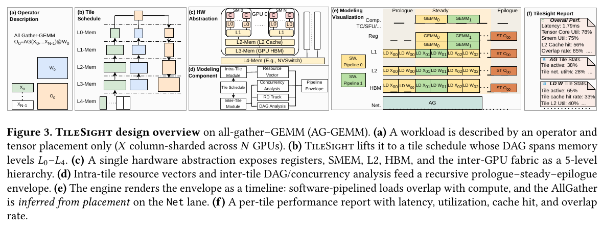
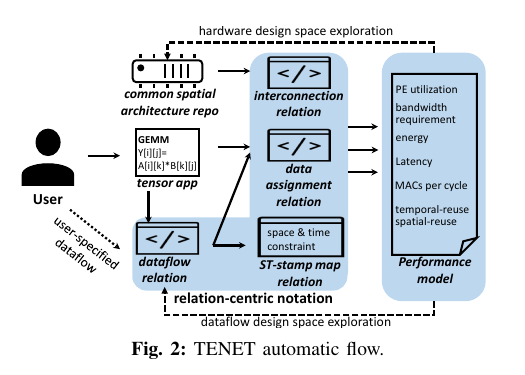
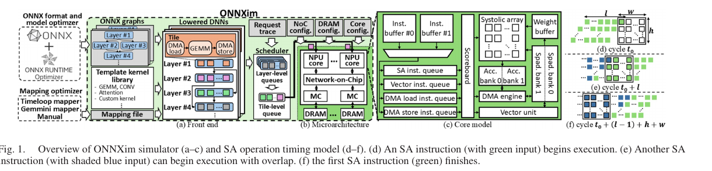
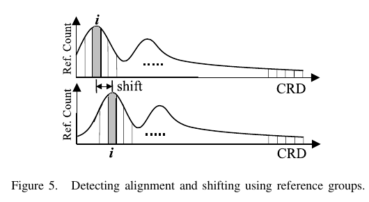
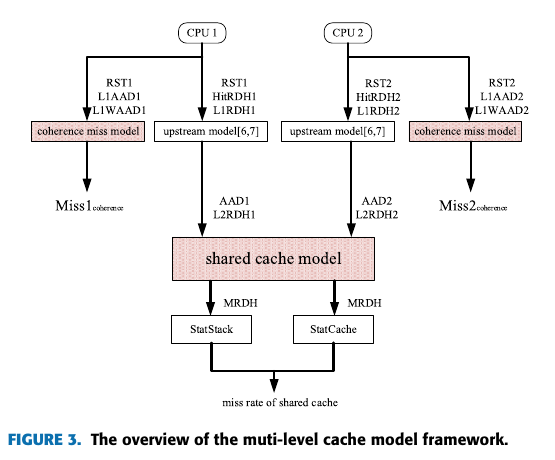
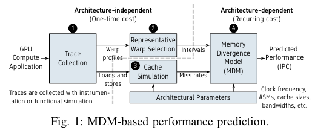
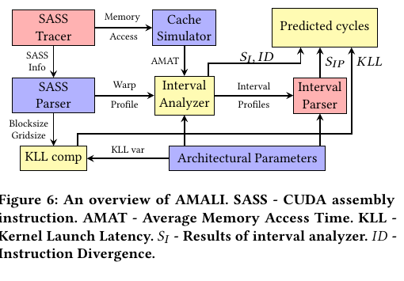
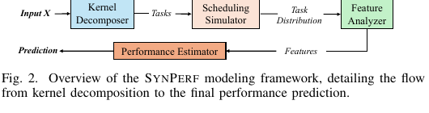
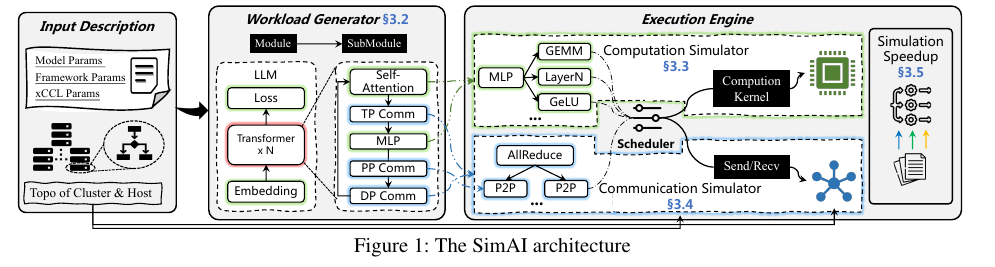

# NPU/GPU 性能建模与架构论文阅读笔记

本笔记覆盖 10 份 PDF、9 项研究：《Analytical Modeling the Multi-Core Shared Cache Behavior》有早期稿与 IEEE Access 期刊版两份。每份文件均单独标注，以免混淆版本中的实验数字。图像从本地 PDF 原页裁取，保留论文原图题；页码指当前 PDF 的页序。这里的 Cache/PE/NoC 方法可借鉴，但不能直接视为 Ascend MoE 融合算子上的性能结果。目录另有 GCoM PDF，本次指定的新增笔记不包括它。

## 1. TileSight: A First-Principles Tile-Centric Analytical GPU Performance Model from Cores to Clusters

**文件**：`gpu-comp-com.pdf`；Zhiwen Mo 等；2026，预印本。

### 研究背景与 Motivation

Triton、TileLang 等以 tile 为核心编程单位，而传统 roofline 对 tile 内指令流水、跨 tile 依赖与 cache locality、GPU 间交换的描述过粗。学习式预测器还需每架构数据。作者希望建立可以从单芯片扩展到集群、并可解释瓶颈的白盒延迟模型（Sec. 1–2）。

### 系统 Overview

Fig. 3 将算子与张量位置映射为 tile schedule；统一表示寄存器、共享内存、L2、HBM、网络五级资源；用 tile 内资源向量、tile 间依赖 DAG 和 cache 重用距离构成时间线，最后输出延迟、利用率、cache hit 与重叠率。图中 AllGather-GEMM 恰是计算通信融合的示例，而不是纯 GEMM。

### Insight → Design

- **Tile 是算子与硬件资源的共同抽象。** 将算子转换为 tile action DAG，并为每个 action 赋计算、访存、通信资源向量；不同合法拓扑序会带来不同资源 overlap（Sec. 3.1–3.4）。
- **峰值带宽不足以反映实际 cache 行为。** 用 tile reuse distance 与容量/带宽微基准估计 L2 hit、有效内存流量（Sec. 3.5）。
- **跨设备交换应进入同一时间线。** 按张量 placement 推断通信，使用拓扑与经微基准校准的 α–β 模型估计各阶段，在 prologue–steady–epilogue 流水框架中递归计算总时延（Sec. 3.6、Alg. 1）。

### 实验设计与结果

评估涉及 A100、H200、B200、B6000 等 GPU，以及 8/32-GPU 设置；对象包括 GEMM、FlashAttention/融合 kernel、collective、vLLM 与 DeepSeek-V3/Qwen3 MoE。与 roofline、GenZ、PipeWeave 等比较预测误差，并检验 L2 hit 预测和 cost-model 调参作用（Sec. 5、Figs. 5–12）。单 GPU pooled MAPE 为 **12.35%**；融合分布式 kernel wMAPE **16.18%**；vLLM decode wMAPE **13.52%**；MoE 配置随设备/模型不同约 **7.5%–16.6% wMAPE**。模型用于 TileLang 剪枝与优化诊断，但这些是 GPU 实验，不等于 Ascend 上的精度。

### 课题关联与局限

可把融合算子的 AIC/AIV tile 依赖、片上缓存和设备间通信放入同一个可校准的 critical-path 模型。需要重写硬件资源向量、DMA/事件、链路拓扑和路由分布特征；原文分布式误差仍在十几个百分点，说明仅有解析资源参数不足以覆盖全部干扰。

## 2. TENET: A Framework for Modeling Tensor Dataflow Based on Relation-centric Notation

**文件**：`ISCA_2021_TENET.pdf`；Liqiang Lu 等；ISCA 2021。

### 研究背景与 Motivation

空间加速器上同一 tensor 算子有大量 PE 映射和执行顺序。compute-centric/data-centric 指令式记法难表达 skewed 数据流和多种互连，因而遗漏数据重用与空间并行机会，使延迟、带宽、能耗估计失真（Sec. I–II、Fig. 1）。

### 系统 Overview

Fig. 2 从共同的 PE/互连架构表示与 tensor 应用出发，构造 dataflow relation、data-assignment relation 和 space-time stamp map relation，再导出 PE 利用率、带宽、能耗、时延和复用指标；这些 relation 同时支撑 dataflow 与硬件设计空间搜索。

### Insight → Design

- **计算发生位置、时刻和数据赋值可统一为关系。** 用 relation-centric 的 affine 映射表达 loop instance→PE、loop instance→time，以及数据 access/PE 互连，扩展可表示的 dataflow（Sec. III–IV）。
- **关系计数能直接导出模型输入。** 使用整数集合和关系操作计算 unique/total data volume、空间与时间复用、PE 利用率及通信量；延迟模型将通信与计算视为流水，取关键瓶颈（Sec. V）。

### 实验设计与结果

先以 GEMM、2D-CONV、MMc、MTTKRP、Jacobi-2D 五类算子比较 dataflow 表达与性能指标，再在 GoogLeNet、MobileNet、ALS、Transformer 等应用上检验；以相同 PE 数、带宽、buffer 和 mesh 网络配置对照 MAESTRO（Sec. VI、Tables III–IV、Figs. 6–12）。使用更丰富 dataflow 后，2D-CONV 与 GEMM 的平均 latency 分别降低 **37.4%** 和 **51.4%**（论文摘要及 Sec. VI），主要是发现既有记法未覆盖的映射。此数字是候选 dataflow 搜索后模拟/模型估计的收益，不能解读为真实 Ascend 设备上的实测加速。

### 课题关联与局限

适合形式化表示 MoE fused operator 的 token/tile→AIC/AIV 任务映射与数据移动，并构造模型的运算/访存计数。它针对 PE 阵列内 tensor dataflow；跨 NPU All-to-All、路由偏斜和实际同步开销不在其模型主体，需要额外扩展。

## 3. ONNXim: A Fast, Cycle-Level Multi-Core NPU Simulator

**文件**：`ONNXim_A_Fast_Cycle-Level_Multi-Core_NPU_Simulator.pdf`；Hyungkyu Ham 等；IEEE Computer Architecture Letters 2024。

### 研究背景与 Motivation

现有 NPU 模拟器往往在速度、多核/多租户、NoC/DRAM 争用和模型输入格式之间取舍。服务器级 NPU 需要验证多核共享资源，而逐周期模拟全部计算代价过高（Sec. I）。

### 系统 Overview

Fig. 1(a–c) 显示 ONNX 图经优化和 tile lowering 后进入 layer/tile 队列、全局调度器、多核/NoC/DRAM 模型；Fig. 1(d–f) 解释 systolic-array 指令的重叠时序。

### Insight → Design

- **片上 SRAM 的 tensor tile 计算时延较确定。** 用事件驱动的 systolic-array/向量核心时序代替对每个计算周期的显式推进，同时保留 DMA 与计算依赖（Sec. II-B）。
- **共享资源争用必须保留周期级精度。** 以 Ramulator 2.0 和 Booksim 建模 DRAM/NoC；ONNX 作为输入，接入 ONNX Runtime 优化、Timeloop 映射与可扩展 kernel template、全局多租户调度（Sec. II-A–C）。

### 实验设计与结果

使用 Mobile/Server 两类 NPU 参数配置，与 Accel-Sim、SMAUG、mNPUsim 的模拟速度比较；以 Gemmini RTL 检验核心执行时间，并研究 GPT-3 与 ResNet-50 并发时的 p95 token 间隔（Sec. III、Fig. 2）。相对 Accel-Sim 模拟速度最高 **365×**；与 Gemmini RTL 比较的平均绝对时延误差 **0.61%**、相关系数 **0.99**。在所设 Server NPU 的并发实验中，ResNet-50 batch 从 1 增至 32，GPT-3 p95 TBT 增加 **47%**。RTL 校验只覆盖核心、且排除了 Gemmini 不支持的 softmax/normalization/skip connection，不能把 0.61% 当作完整系统精度。

### 课题关联与局限

它提供“算子 tile 计算事件驱动 + 共享 NoC/DRAM 争用细化”的多层建模思路；适合用来决定融合模型哪些阶段需要精细模拟。论文的 NPU 是抽象 systolic-array 架构，并非 Ascend；没有专家并行 All-to-All 或 MoE 负载分布。

## 4. Coherent Profiles: Enabling Efficient Reuse Distance Analysis of Multicore Scaling for Loop-based Parallel Programs

**文件**：`Coherent_Profiles_Enabling_Efficient_Reuse_Distance_Analysis_of_Multicore_Scaling_for_Loop-based_Parallel_Programs.pdf`；Meng-Ju Wu、Donald Yeung；PACT 2011。

### 研究背景与 Motivation

多线程交错令 concurrent reuse-distance (CRD) profile 随 core 数变化，单一测量不能直接预测新规模的 LLC miss。逐配置测量或模拟的成本又随 core/cache/问题尺寸空间迅速上升（Abstract、Sec. I–II）。

### 方法示意图（论文无系统 Overview 图）

Fig. 5 展示将少量已测 CRD profile 划为 reference groups，对齐后推断不同 core 数下的 coherent shift；这不是系统架构总图。

### Insight → Design

- **loop-based 并行线程具有对称性，CRD 曲线随 core 扩展表现为可预测位移。** 从 2/4 核样本识别参考组的位移率，再外推到 8–256 核（Sec. II–III）。
- **共享与私有引用的变化方式不同。** 分别处理 CRD_P 与 CRD_S，后者加入 spread 项，合并成 whole-program profile，再估算 LLC cache-miss count/MPKI（Sec. III、Figs. 5–7）。

### 实验设计与结果

以 PIN 采样 9 个 benchmark、每个 4 种问题尺寸，比较预测与测得的 CRD/CMC；结合 cache/问题规模模拟检查 1,728 种配置（Sec. III–IV、Figs. 6–13）。只用 **36 个已测 profile**，可将 LLC MPKI 预测到模拟结果的 **11.1% 以内**（Abstract）。作者同时观察到 core 扩展影响主要集中在小于 16 MB 的 LLC；问题尺寸放大 64 倍时阈值升至 64–128 MB。结果面向 loop-based 程序及论文设定的多核缓存层级。

### 课题关联与局限

可借鉴少量 profile 外推缓存行为和分离共享/私有复用的思路，作为 MoE tile 复用预测的灵感；但 CPU 线程交错、共享 LLC 与 Ascend 的多级 SRAM/L2、专家路由语义不同，不能直接迁移公式。

## 5. Analytical Modeling the Multi-Core Shared Cache Behavior With Considerations of Data-Sharing and Coherence（IEEE Access 期刊版）

**文件**：`Analytical_Modeling_the_Multi-Core_Shared_Cache_Behavior_With_Considerations_of_Data-Sharing_and_Coherence.pdf`；Ming Ling 等；IEEE Access 9，2021，DOI 10.1109/ACCESS.2021.3053350。

### 研究背景与 Motivation

共享 L2 的输入访问流来自各核心私有缓存；若要直接取得 L2 的 reuse/stack-distance histogram，传统方法需对每种架构做耗时模拟。线程共享数据与私有缓存一致性失效又使简单的流合并误差变大（Abstract、Sec. I–II）。

### 模型 Overview

Fig. 3 将 CPU trace 特征、上游私有缓存模型和 coherence miss 模型汇入共享 L2 的 reuse-distance 分布，再用 StatStack/StatCache 求 miss rate；这表明上游错误会传播到下游估计。

### Insight → Design

- **共享数据造成的插入/拆分影响可从地址关联与访问统计中解析估计。** 从核心 trace 的局部 RDH、RST/AAD 等统计构建合并后的共享缓存 MRDH，不逐配置模拟完整多级缓存（Sec. III、Figs. 4–6）。
- **一致性 miss 必须显式处理。** 为私有缓存增加 coherence miss 模型，并与上游缓存模型和下游共享 L2 模型串联（Sec. IV、Figs. 9–11）。

### 实验设计与结果

用 gem5、PARSEC 2.1 的 13 个应用、8 种双核/四核配置独立检验共享 L2 miss；再以 10 个应用、4 种双核配置检验私有/共享缓存串联，并分析 57 种架构配置（Sec. V–VI、Tables 1–3、Figs. 12–19）。共享 L2 miss rate 平均绝对误差在各配置中 **低于 2%**；集成上游 coherence 模型后 4 种配置平均绝对误差 **4.82%**（本期刊版摘要）。共享数据强的 canneal、fluidanimate、vips 相对 StatCC 获益尤其明显。不同阶段采用不同应用/配置数量，不能混为同一实验。

### 课题关联与局限

启发是把 cache 复用、跨核共享和同步/一致性分层建模，再显式分析误差传播。模型对象仍是 CPU 私有缓存/共享 L2，不包括 NPU 的 AIC/AIV、L1/UB/L0 存储、DMA 与跨卡通信；用于课题时应只借结构和验证方法。

## 6. 同题早期稿：Analytical Modeling the Multi-Core Shared Cache Behavior With Considerations of Data-Sharing and Coherence

**文件**：`multi-core_model.pdf`；Ming Ling 等；早期论文稿，13 页；与上一条为同一工作不同版本。

### 研究背景、Motivation 与 Design

背景和核心 insight 与期刊版一致：共享缓存 miss 由多核访问流合并、跨线程数据共享和私有缓存 coherence 共同决定；以 RDH/RST/AAD 等 trace 统计构建 L2 miss 解析模型，串联上游缓存与 coherence miss 估计，避免每种配置进行完整 gem5 仿真（Sec. I–IV）。

### 模型 Overview

本稿 Fig. 3（PDF 第 2 页）与期刊版为同一模型框架。下图引用期刊版的高质量排版图；箭头含义不变，但本稿的实验结果以本稿数字为准。

### 实验设计与结果

以 PARSEC 2.1 的 13 个应用、8 种双核/四核硬件配置和 gem5 检验共享 L2 预测，再比较上游/下游模型串联误差；并用于 57 种缓存配置的设计空间分析（Abstract、Sec. V–VI）。共享 L2 miss rate 平均绝对误差仍为 **低于 2%**，但本稿摘要给出的集成模型 4 配置平均绝对误差是 **8.03%**，不同于期刊版的 **4.82%**。论文版本不同，不能在笔记或对比表中无说明地互换这两个数字。

### 课题关联与局限

这份 PDF 为比较模型迭代和误差改进提供原始版本；对 MoE/NPU 模型可借鉴数据共享建模与逐层误差核查，但不构成独立于期刊版的第二项方法成果。

## 7. MDM: The GPU Memory Divergence Model

**文件**：`Wang 等 - 2020 - MDM The GPU Memory Divergence Model.pdf`；Lu Wang、Magnus Jahre、Almutaz Adileh、Lieven Eeckhout；MICRO 2020，DOI 10.1109/MICRO50266.2020.00085。

### 研究背景与 Motivation

GPU 的线程级并行通常能够隐藏访存延迟，但稀疏、步长式或数据依赖访问会让同一 warp 的线程触及不同 cache line。作者在六套 benchmark 的 56 个应用中按 divergent loads per kilo instructions（DPKI）识别出 21 个 memory-divergent（MD）应用；GPUMech 对该类应用的平均 IPC 预测误差为 298%。根因有二：L1 未命中数超过 miss status holding registers（MSHR）容量后发生 cache blocking，warp 无法继续借其他线程隐藏时延；大量请求又令 NoC 与 DRAM 排队，而旧模型没有准确计入这些等待（Sec. I、Table I）。

### 系统 Overview

**原文图**：Fig. 1，PDF 第 3 页，标题为“MDM-based performance prediction”。图中流程先以 NVBit 二进制插桩或功能模拟收集指令/地址轨迹，再生成 warp interval profile；随后将全部 warp 的访存轨迹交给 cache simulator 求 miss rate，最后把 interval、cache 结果和架构参数送入 MDM，输出 GPU IPC（Sec. II）。

### Insight → Design

- **Insight 1：内存分歧的核心代价是请求被有限 MSHR 分批处理。** 若一个 interval 的并发读 miss 数 `M_read × W` 大于 MSHR 数，MDM 将其标记为 MD interval；用 `ceil(M_read × W / #MSHR) - 1` 估计额外批次数，乘以含无争用访问与排队的访存时延，得到 MSHR 阻塞周期（Sec. III-C1，Eqs. 2–6）。写 miss 在论文所建模的 write-through、no-allocate L1 中不占该 MSHR 上限，单独计入并发请求数。
- **Insight 2：一旦 MSHR 阻塞破坏线程级时延隐藏，NoC/DRAM 排队会完整暴露。** 用 cache block 大小、时钟、NoC/DRAM 有效带宽和 miss ratio 估计服务时间，再由在途请求数、SM 数和通道并行度估计排队；对饱和的 MD interval 计入完整排队代价，对其他 interval 使用半延迟启发式（Sec. III-C2，Eqs. 7–10）。
- **Insight 3：工作负载轨迹和硬件配置的成本可分离。** 一次采集架构无关轨迹并选 representative warp；每个候选架构仅重跑 cache 模型与解析方程。最终以每 interval 的基础执行周期加 MSHR、NoC、DRAM 停顿求 IPC，从而支持设计空间扫描（Sec. II、III-C，Fig. 1、Eq. 1）。

### 实验设计与结果

作者以 GPGPU-Sim 3.2 的周期精确结果为主要对照，评估 17 个完整运行的应用（8 个 NMD、9 个 MD），来自 Rodinia、SDK、Polybench、Parboil、MARS、Tango；比较 GPUMech、加入简易 NoC 模型的 GPUMech+、仅改队列的 MDM-Queue、仅改 MSHR 的 MDM-MSHR 与完整 MDM。误差定义为模型与模拟 IPC 的绝对相对误差，并扫描 NoC/DRAM 带宽、MSHR 数及 SM 数。另在 GeForce GTX 1080 上用 NVBit 原生指令轨迹对比实机 IPC（Sec. IV–VI、Tables III–V、Figs. 5–10）。

- 模拟基准配置上，全部 17 个应用平均误差 **13.9%**（GPUMech **162%**）；MD 子集为 **18%**（GPUMech **298%**），NMD 子集约 **9%**。只加排队或只加 MSHR 模型，MD 平均误差仍分别为 **63%** 与 **60.3%**，两项机制须合用（Sec. V-A、Fig. 5）。
- 对真实 GTX 1080，以二进制插桩提供输入时，MDM 平均误差 **40%**，GPUMech 为 **164%**；插桩采集轨迹比功能模拟约快 **612×**，折算完整模型评估约快 **6.1×**。因此 13.9% 不能写成实机误差（Sec. VI、Fig. 10）。
- Fig. 11–12 的设计空间案例表明，对 MD 的 CFD，GPUMech 错误高估增加 SM/DRAM 带宽的收益，MDM 预测趋势与模拟一致。DVFS 案例的相对性能误差为 MDM **4.6%**、专用 CRISP **3.7%**、GPUMech **28%**；对 streaming L1 的测试仍能通过 NoC 队列容量表达分批行为（Sec. VII、Figs. 11–15）。

### 课题关联与局限

MoE 路由偏斜可能改变访问离散度、在途请求量和通信队列压力；可借鉴“按流量形态区分等待机制，再把 contention 放进关键路径”的建模方法，并设计小规模硬件实验校准容量与服务率。但 MDM 面向早期 NVIDIA GPU 的普通访存负载，未建模 tensor core、跨卡 collective、计算通信融合或 Ascend AIC/AIV/MTE。其 NMD 半延迟属于启发式，实机 40% 平均误差提示迁移时不能直接复用系数（Sec. III-C、VI）。

## 8. AMALI: An Analytical Model for Accurately Modeling LLM Inference on Modern GPUs

**文件**：`Cao 等 - 2025 - AMALI An Analytical Model for Accurately Modeling LLM Inference on Modern GPUs.pdf`；Shiheng Cao 等；ISCA 2025，DOI 10.1145/3695053.3731064。

### 研究背景与 Motivation

GCoM 等 GPU 解析模型对 LLM 推理中的 tensor core GEMM、element-wise kernel 误差较大：把 CUDA-core 的发射间隔公式直接用于 HMMA，会高估 `math_pipe_throttle`；忽略 HMMA 的数据类型/矩阵尺寸 modifier、immediate constant cache 与 instruction cache 停顿，又会漏算时延；同一 kernel 的不同 warp 指令数还可能相差很大，单一 representative warp 无法代表尾部工作量。论文以 RTX 3090 上的 CPI stack 与指令分布展示这些失配（Sec. I、III、Figs. 2–5）。

### 系统 Overview

**原文图**：Fig. 6，PDF 第 8 页，标题为“An overview of AMALI”。SASS Tracer/NVBit 收集指令 modifier、寄存器、地址、grid/block 与 warp/SM 信息；SASS Parser 和 Cache Simulator 生成 representative warp 与平均访存时间；Interval Analyzer/Parser 分解依赖及结构性停顿；KLL comp 估计发射相关延迟，合并架构参数输出 kernel cycles（Sec. IV-A–F）。

Fig. 1（PDF 第 3 页）是 Ampere GPU 架构背景图，不是 AMALI 系统图。

### Insight → Design

- **Insight 1：tensor core 一条 HMMA 的代价取决于指令 modifier 和数据类型对应的吞吐，而非 CUDA-core lane 数。** 对不同 HMMA 形状和精度用微基准校准 FMA/cycle，令 tensor-core initiation interval 与指令 FMA 数/对应数据类型吞吐相关，再并入 interval analysis 的 `math_pipe_throttle` 和依赖时延（Sec. III-A、IV-G，Figs. 2–3，Eqs. 25–26）。
- **Insight 2：小 kernel 的 constant/instruction-cache 相关停顿可用与 grid/block 相关的 kernel-launch latency（KLL）校准。** 微基准观测在固定 block size 下 KLL 随 grid size 近似线性，斜率再以 block size 的二次函数拟合；将此项加入总周期以弥补旧模型对 element-wise kernel 的低估（Sec. III-B、IV-H，Fig. 7，Eqs. 27–28）。这是经验代理量，而不是分别求出两种 cache 的 miss 率。
- **Insight 3：LLM kernel 的负载不均衡更多体现在 warp 指令数而非 warp 个数。** 保留 representative-warp interval 模型，同时用各 sub-core 的最大指令量与代表 warp 所在 sub-core 指令量之差估计尾部 idle cycles（`ID`）；总周期由 interval、结构性停顿、KLL、ID 汇总（Sec. III-B、IV-I，Fig. 5，Eqs. 16、29）。此外 memory-side `mio_throttle` 继承 MDM 的 MSHR/NoC/DRAM 争用模型（Sec. IV-F，Eq. 24）。

### 实验设计与结果

主要实验在单张 NVIDIA A100 80 GB（CUDA 11.7）上，以真实硬件 NCU 周期计数为基准，比较 GCoM 与逐项加入 TCM、KLL、ID 的模型。负载含 Llama3-8B（prompt 128–6144 token、256-token 时变 batch）、论文构造的 Llama3-15B，以及 DeepBench CONV/GEMM 和 Rodinia 核；因轨迹文件很大，作者用第一个输出 token 代表 prefill、第二个代表 decode，硬件周期测 10 次取均值。H100 的 tensor-core 吞吐差异另用于五个 DeepBench GEMM 的设计空间验证（Sec. V–VI、Table 2，Figs. 8–16）。

- 高频、较长的 Llama3-8B kernel 集合上，AMALI MAPE **23.59%**、GCoM **127.56%**（摘要；Sec. VI-C 文本四舍五入为 23.5%/127.6%）。其中 GEMM 为 **17.84% vs 183.95%**，element-wise 为 **27.29% vs 77.81%**；TCM 对 GEMM 贡献最大，KLL 对 element-wise 贡献最大（Sec. VI-C，Figs. 9–10）。
- Llama3-8B 不同 prompt 的推理阶段预测中，prefill 平均 MAPE **15.56% vs GCoM 163.68%**，decode **34.90% vs 82.29%**；误差在两个阶段差别明显，不能把 kernel 集合的 23.59% 作为所有端到端场景的统一精度（Sec. VI-C，Fig. 11）。
- 对五个 DeepBench GEMM 的 A100/H100 吞吐设计验证，AMALI 相对实测 kernel cycles 的平均误差分别为 **8.2%/13.2%**；论文报告单例最低 **1.03%**、最高不超过 **23%**。GCoM 无法随假设的 tensor-core FMA/cycle 改变预测周期（Sec. VI-D，Figs. 15–16）。

### 课题关联与局限

可迁移的思路是先用硬件实测拆解 stall 来源，再对 AIC/Cube、AIV/Vector、MTE 和 kernel 启动建立不同的校准项；对 MoE 的非均衡 expert/token 分布也不能只用“代表任务”，应显式刻画尾部。AMALI 自身只验证 NVIDIA 单卡推理和传统 kernel，不包含 MoE、NPU 或跨卡通信；KLL 是针对 Ampere 的经验拟合，论文的 H100 验证也主要限于 GEMM 吞吐变化。论文只取前两个输出 token 作为推理阶段样本，复杂动态路由场景还需重新验证（Sec. V–VI）。

## 9. SynPerf: A Hybrid Analytical-ML Framework for GPU Performance Prediction

**文件**：`Zhang 等 - 2026 - SynPerf A Hybrid Analytical-ML Framework for GPU Performance Prediction.pdf`；Kaixuan Zhang 等；arXiv:2601.14910v1，2026。以下页码为本地 PDF 页序。

### 研究背景与 Motivation

LLM 推理框架包含 GEMM、Attention、归一化和 fused kernel，而新 GPU 架构更新频繁，逐硬件实测难以覆盖配置空间。周期模拟成本高；纯解析模型难以刻画异构流水线争用；已有 tile 级数据驱动模型把 SM 视为粗粒度整体，常忽略 fused kernel 的非加性行为和 SM 间任务不均衡。作者据此要求模型同时具备可解释的硬件特征、跨架构泛化能力和秒级预测速度（Sec. I、III）。

### 系统 Overview

**原文 Fig. 2，PDF 第 4 页**：Kernel Decomposer 将输入形状与硬件规格映射为任务；Scheduling Simulator 将任务分配至各 SM；Feature Analyzer 计算 Tensor/FMA/XU 与内存流水线在 task、SM、GPU 三层的需求和理论周期；Performance Estimator 用小型 MLP 输出预测时延。

### Insight → Design

- **Insight 1：kernel 的实际可调度单位取决于执行范式。** Design：常规 kernel 以 CTA 为 task，persistent kernel 以驻留 CTA 从全局队列取出的 tile 为 task；从开放源码推导任务映射，对闭源 cuBLAS 根据 profiler 中的 kernel 名、CTA 数及输入形状反推映射（Sec. IV-A、V-A）。
- **Insight 2：总工作量相同，SM 分配和最慢 SM 仍可能决定尾部时延。** Design：模拟常规 kernel 的近似 round-robin 调度和 persistent kernel 的软件 tile scheduler，保留每个 SM 的任务集合，并提取最大 SM 负载特征（Sec. IV-B、V-A）。
- **Insight 3：单一 FLOP/byte 比无法描述 Tensor、FMA、XU 与不同层级内存管线的争用。** Design：解析计算每条主要数学流水线的操作数/理论周期与各层级读字节数/理论周期，在 task→SM→GPU 层级汇总，不把它们预先压成一个 roofline 指标（Sec. IV-C，Tables II–IV）。
- **Insight 4：已知资源下界之外的非线性耦合可由少量数据学习。** Design：每类 kernel 训练独立的三隐藏层 MLP（256/128/64），以硬件实测时延训练执行效率 `理论时间/实测时间`，再用理论时间除以预测效率求时延；另用 P80 分位损失估计 fused MoE kernel 的高性能参考值，筛出值得调参的配置（Sec. IV-D、V-C、VII）。

### 实验设计与结果

训练/测试覆盖 11 种 NVIDIA GPU、Ampere/Ada/Hopper/Blackwell 四代架构，其中 6 种用于训练、5 种只用于未见硬件测试；内核来自 SGLang、vLLM、FlashInfer、cuBLAS，涵盖 Attention、GEMM、RMSNorm、SiLU&Mul、FP8 Scaled MM，另有 33,264 个 fused MoE 样本用于优化案例。每配置 5 次预热、10 次计时取平均。比较 Roofline、线性回归与 Neusight；端到端用 Qwen2.5-14B、Qwen3-32B、Llama3.1-70B，Arxiv Summarization/Splitwise 请求，单卡及 TP/PP 配置；通信核另用按拓扑/消息大小采样的回归库，端到端假设 kernel 串行、不考虑计算通信重叠（Sec. V、VI）。

- 解析部件在 A100/H100 的约 500 个/实现测试点上，CTA 数与实测一致；总数学操作数最大误差 0.5%，最大单 SM 操作数最大误差 6.34%（Table VII）。消融显示 MIO 特征、数学流水线特征和 MLP 均影响误差（Fig. 4）。
- 摘要报告 kernel 平均误差 **6.1%**（已见 GPU）与端到端 **8.5%**；正文 Sec. VI-C 对约百万 kernel 样本报告已见/未见 GPU 的 MAPE 分别 **6.0%/11.5%**，Neusight 为 **42.6%/45.1%**。正文 Sec. VI-D 单卡 Qwen2.5-14B 平均 **11.3%**（未见 GPU 12.5%），20 组分布式配置平均 **6.6%**（Neusight 34.7%）。摘要与分项正文的汇总口径不完全相同，应分别引用，不能互换。
- 在 fused MoE 调优中，P80 性能差值大于 0.1 的配置定义为低效点；A40 有 921 个（占 A40 样本 30.4%），H20 为 0。对 A40/L20/A100/H800 各约 70 个点调整 `BLOCK_SIZE`、`num_stages`、`num_warps` 后，A40 平均差值由 **0.187→0.083**，L20 由 **0.274→0.215**（Sec. VII，Figs. 7–8）。摘要与引言称 fused MoE kernel **最高 1.7×** 加速，但 Sec. VII 未给出该最大值的配置级时延表；此数应标为作者摘要声明。

### 课题关联与局限

对 NPU MoE 融合算子的性能模型，可迁移“按实际调度任务分解→分别估算 AIC/AIV/搬运/网络流水线需求→最慢执行单元负载→小模型修正”的框架，P80 差值也可用于筛选优化点。但论文全部实测在 NVIDIA GPU，融合 MoE 案例是单 kernel 调参而非跨 NPU 的 All-to-All/计算重叠；端到端模型把 kernel 串行相加，分布式通信通过单独回归估计，无法直接预测融合通信的关键路径。迁移还需校准 Ascend 的硬件资源与调度规则（Sec. V-D、VII）。

## 10. SimAI: Unifying Architecture Design and Performance Tuning for Large-Scale Large Language Model Training with Scalability and Precision

**文件**：`Wang 等 - SimAI Unifying Architecture Design and Performance Tuning for Large-Scale Large Language Model Trai.pdf`；Xizheng Wang 等；NSDI 2025。PDF 第 1 页是 USENIX 封面，正文从第 2 页开始；以下页码为本地 PDF 页序。

### 研究背景与 Motivation

大规模训练部署前需要评估 GPU/主机/网络设计与并行策略，而真实千卡实验代价高。只模拟算力或粗粒度通信会遗漏训练框架的操作依赖、NCCL 的算法和路由选择；细粒度网络/设备模拟又可能慢到无法做设计空间探索。论文举例：早期方案模拟 128 GPU 的 GPT-3 一个 iteration 超过 24 小时，而真实集群约 2 秒。目标是统一训练工作负载、计算核、collective、网络拓扑与事件调度，并让大规模仿真可运行（Sec. I、II）。

### 系统 Overview

**原文 Fig. 1，PDF 第 5 页**：输入模型/框架/CCL 参数及集群拓扑；SimAI-WG 从 Megatron/DeepSpeed 生成带计算、TP/PP/DP/EP 通信和依赖的 workload；Execution Engine 按事件调度，分别调用 SimAI-CP 计算时延库与 SimAI-CM 通信仿真；底层通过并行与共享状态优化提速。

Fig. 2（PDF 第 6 页）更详细地画出计算与通信可重叠的依赖箭头。

### Insight → Design

- **Insight 1：工作负载精度首先取决于训练框架的真实控制流与依赖。** Design：在单机虚拟多 rank、跳过实际 NCCL 数据传输，运行 Megatron/DeepSpeed 来生成算法模块、通信操作及 happens-before/可重叠依赖；用 1,024 GPU Nsight Systems trace 验证依赖，独立保存 workload 供仿真（Sec. 3.2，Fig. 2）。
- **Insight 2：已有 GPU 的 kernel 时间实测比泛化的详细微架构模拟更适合大规模系统仿真。** Design：SimAI-CP 按 GPU、形状、子模块/细粒度 kernel 建操作时间库；对于未上市或不可得 GPU，用已知 GPU 的计算/内存瓶颈类别和 roofline 式规格缩放估算（Sec. 3.3，Tables 1、4）。
- **Insight 3：collective 的低层通信形态由 NCCL 初始化、拓扑与算法选择决定。** Design：SimCCL 拦截 NCCL 初始化/collective 调用，读取虚拟拓扑并复用关键 NCCL 流程，把 AllReduce/AllGather/ReduceScatter 展开为含大小、rank、路径的点对点流，交由网络仿真（Sec. 3.4，Fig. 3）。
- **Insight 4：大规模事件仿真的共享全局状态会限制多线程收益。** Design：在 NS-3/UNISON 并行事件框架中按节点 ID 拆分原全局变量，避免全局锁；相对单线程提速 23×，相对仅多线程提高 15%（Sec. 3.5，Fig. 4）。

### 实验设计与结果

以实物 A100/H100 集群为 ground truth：各 128 台、每台 8 GPU，均为多轨 fat-tree RoCEv2，NVLink 单机互联；评估 128、512、1,024 GPU，代表模型 GPT-3 13B/175B、LLaMA 65B，并给 ASTRA-sim 配同一 SimAI-WG workload 作为 baseline。分别测 intra/inter-host collective 带宽、计算核时延、训练 iteration 时间，另做 H100/H20 网络带宽及 TP 参数设计案例（Sec. 4–5）。

- 单机 collective 的平均偏差：SimAI 在 A100/H100 分别 **3.9%/2.3%**，ASTRA-sim **74.8%/51.7%**（Sec. 4.2，Fig. 6）。跨机 small-message 等场景的 ASTRA-sim 误差增大；作者也说明 SimAI 未显式模拟 libibverbs 与 NIC pipeline，仍有小消息误差（Fig. 7）。
- 计算核：已有 GPU 实测数据库 SimAI-CP 的总时延差 **0.5%–3.1%**；未知 GPU 的 SimAI-CP-Model 规格外推误差 **13%–15%**。ASTRA-sim 的 SCALE-sim 仅能成功运行矩阵乘核，比较结果包含额外 FLOPS 缩放，不能视作完全同条件的所有核比较（Sec. 4.3，Fig. 8）。
- 训练 iteration：SimAI 对真实集群偏差 **低于 3.9%**，包含 1,024 GPU；摘要将其表述为平均 **98.1%** 对齐（即平均偏差约 1.9%），这不是所有单项配置的误差（Sec. 4.4，Fig. 9）。H100 1,024 GPU 设计案例中，200→400 Gbps 网络带宽对应仿真训练性能 **+19%**；H20 100→200 Gbps **+11%**、200→400 Gbps **+6%**（Sec. 5.1，Fig. 10）。

### 课题关联与局限

SimAI 可作为融合算子在训练系统中的上层验证框架：把算子级时延模型接入 SimAI-CP，让计算、collective、拓扑、TP/EP/DP 依赖置于同一事件时间线，检验局部优化能否转化为 step-level 收益。但它的核心计算时延依靠已有 GPU 测量库，未知设备精度明显下降；更关键的是，SimCCL 对 EP 门控造成的数据依赖路由**假设 token 均衡分布**（Sec. 3.4），不能验证 skew-aware MoE 融合优化。其 NVIDIA/NCCL/RoCEv2 路径也需要针对 Ascend 通信栈重新实现和校准。
