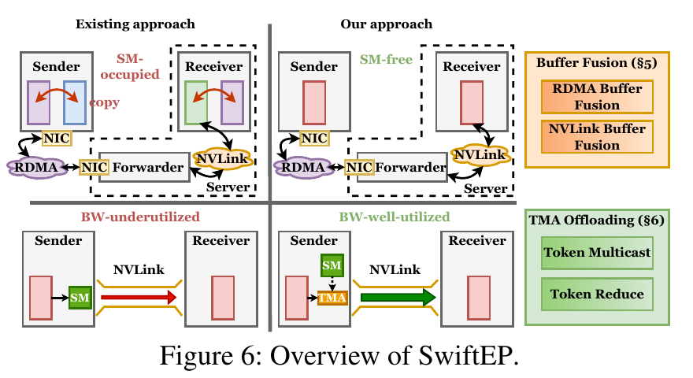
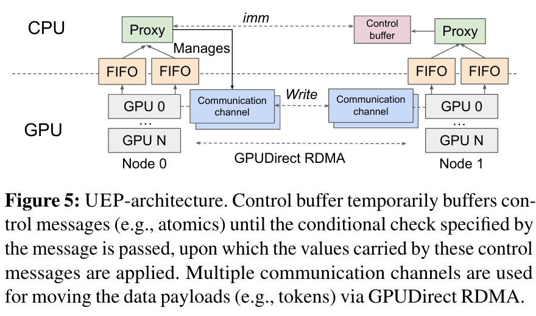
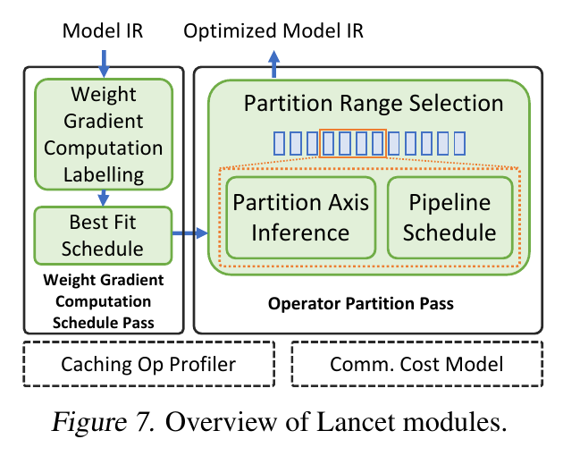

# 专家并行通信与系统：逐篇阅读笔记

本目录收录 3 篇新增论文，关注 MoE 专家并行中 dispatch/combine 的通信路径，以及训练图级计算通信重叠。以下图像均由对应原 PDF 裁取；“PDF 第 n 页”按文件实际页序计（USENIX 文件含封面）。实验数字是原文所报告的 GPU 结果，不能视为 Ascend NPU 的实测结论。

## 1. SwiftEP: Accelerating MoE Inference with Buffer Fusion and TMA Offloading

**文件**：`SwiftEP_NSDI_2026.pdf`；Xingyi Li 等；NSDI 2026。

### 研究背景与 Motivation

MoE 专家并行在 prefill 中需要 dispatch 与 combine 两次跨 GPU 数据交换。DeepEP 等库虽然能配合 two micro-batch overlapping（TBO）隐藏部分通信，但通信 kernel 本身长期占用 SM，挤占专家计算资源；跨服务器的 RDMA 和服务器内 NVLink 传输也未充分用满。作者对 H20 的分析发现，DeepEP 的 24 个通信 SM 中约 71% 的 warp 用于计算缓冲区、RDMA 缓冲区和 NVLink 缓冲区之间的小块拷贝；基于流量和链路峰值推导的 dispatch 算法带宽上界为 EP16 约 94 GB/s、EP32 约 65 GB/s，而实测仍有明显差距（Sec. 3.1–3.3、Fig. 5）。目标是在保留细粒度专家并行通信的同时减少拷贝和 SM 占用。

### 系统 Overview

Fig. 6 将“发送/接收侧多次复制、SM 执行 NVLink 转发”与“融合缓冲区、TMA 执行服务器内传输”并列，表明其融合既涉及**计算输出与通信发送缓冲区的物理布局**，也涉及通信执行资源分配（Sec. 4）。

### Insight → Design

- **多缓冲区之间的中转复制占用 SM，却不产生模型计算。** RDMA Buffer Fusion 将发送侧计算 tensor buffer 与 RDMA send buffer 合并；NVLink Buffer Fusion 将接收侧 NVLink buffer 与计算 tensor buffer 合并，令 token 更接近最终位置。直接融合会使 RDMA 区域增大且片段化，因此再用 scatter-gather list / WQE post coalescing 批量描述小段传输、QP transmission parallelization 分摊 RNIC 地址转换代价；接收方通过增强 notify 获知动态 token 落位（Sec. 4–5、Figs. 7–12）。
- **SM 的 ld/st 转发受寄存器和指令吞吐限制，无法发挥 NVLink 带宽。** 利用 Hopper TMA 的异步数据搬运完成服务器内 token multicast（dispatch）和 reduce（combine），通过 CUDA IPC 允许 TMA 访问远端 GPU 内存；针对多段 token、shared memory 容量与对齐设计动态分配，并重叠大块 hidden state 与小块元数据的加载/发送（Sec. 6、Figs. 13–14）。
- **只减少通信耗时不足以评价融合收益。** 作者分别衡量算法带宽与通信占用的 SM 数，再在启用 TBO 的 SGLang 部署中测 prefill 输入 token 吞吐（Sec. 8）。

### 实验设计与结果

在 2 节点 16 张 GPU（EP16）和 4 节点 32 张 GPU（EP32）的 H20 集群上比较 DeepEP，节点内为 NVLink/NVSwitch、节点间为 ConnectX-7/RoCEv2；微基准采用 4096 token、hidden 7168、top-8，测试 FP8/BF16 dispatch 与 BF16 combine，并改变 token 数与逐项消融。端到端采用 SGLang + DeepSeek-R1、EP16、TBO、FP8 dispatch、ShareGPT 输入，batch 32、平均输入长度 1024、输出长度 1，指标是每 GPU Input Tokens Per Second（ITPS）（Sec. 8.1–8.4）。

- Table 1、Fig. 15：相对 DeepEP，通信占用 SM 在 EP16 降低 **50%**，EP32 降低 **66.7%**。这是通信 kernel 的占用数量，不是整卡 SM 数减少。
- Fig. 17：算法带宽最高提升 **101.8%（FP8 dispatch）**、**107.5%（BF16 dispatch）**、**119.7%（combine）**；这些是分别测得的峰值改善，不能直接相加。
- Figs. 16、18：单独进行 RDMA buffer fusion 可能使带宽下降达 **85%**，需要 QP 并行和 WQE 合并处理地址转换与小消息开销；TMA 卸载、动态 shared memory、传输重叠分别修补不同瓶颈。
- Sec. 8.4：端到端 prefill 平均 ITPS/ GPU 提升 **21.2%**。原文未给出在 Ascend NPU 上的结果。

### 对课题的启发与局限

可把“融合后省去的复制时间”和“释放的计算核心资源”都纳入性能模型，并把缓冲区注册/片段化、地址转换、DMA/TMA、QP 并行视为可能抵消收益的项。SwiftEP 是 NVIDIA Hopper/H20 与特定网络栈上的实现，侧重通信库而非通用 MoE 融合算子预测器；迁移至 NPU 时须对应其 DMA、片上内存、跨卡链路与事件原语重新建模。

## 2. UEP: Portable Expert-Parallel Communication

**文件**：`UEP_OSDI_2026.pdf`；Ziming Mao 等；OSDI 2026。

### 研究背景与 Motivation

MoE dispatch/combine 希望 token 路由刚由 GPU 算出就发起细粒度通信，以与打包、专家计算等阶段重叠。DeepEP 的 GPU 直接操控 NIC 方案依赖 IBGDA 与特定 GPU/NIC 语义，遇到 AMD GPU、AWS EFA 或其他无严格顺序保证的网络时难以移植。粗粒度 NCCL/RCCL 虽易移植，却需要先打包 token，限制小消息流水（Sec. 1–2、Table 1）。作者的目标是保留 GPU 侧 token 级发起时机，同时让不同设备组合共享同一通信架构。

### 系统 Overview

Fig. 5 显示 GPU 把轻量控制命令送入 FIFO，由每 GPU 的多线程 CPU proxy 发出真正的 GPUDirect RDMA；payload 仍直接从 GPU 内存传输。接收侧 control buffer 可暂存先到的控制消息，满足应用需要的到达语义（Sec. 3）。

### Insight → Design

- **细粒度重叠只要求 GPU 及时“发起”，不要求 GPU 亲自管理 NIC。** 设计 128-bit `TransferCmd` 和共享、无锁的 CPU–GPU FIFO；每 GPU 多 FIFO、多线程 CPU proxy 读取命令并经 libibverbs 发起 RDMA。队列 head/tail 放在各自高频读取侧，减少 PCIe 轮询开销；在同一 FIFO 内保持命令顺序（Sec. 3.1–3.2、Fig. 6）。
- **不同网卡的消息到达次序不能被 GPU kernel 隐式假定。** `Write`、`Atomics`、`Drain`、`Barrier` 命令表达数据与同步需求；利用 RDMA immediate data、序号和接收侧 control buffer，延迟应用先到的原子通知，直到对应 token 写入完成。LL 模式重视 decode 小批量低延迟，HT 模式通过去重、服务器内转发与分块提高 prefill/训练吞吐（Sec. 3.3、Fig. 7）。
- **兼容性需要明确的最小硬件接口。** EFA 缺少硬件 RDMA atomics 时由 CPU proxy 模拟；AMD 侧迁移 GPU kernel 的 warp/PTX 假设，而 CPU–NIC 侧继续使用标准 verbs。每 GPU 最多 4 个 proxy 线程，并对 QP/NIC 进行负载分配（Sec. 4）。

### 实验设计与结果

Table 2 的测试床覆盖 NVIDIA H200/B200/H100 与 AMD GPU，以及 EFA、NVIDIA ConnectX 和 Broadcom NIC；基线按平台选择 NCCL/RCCL、DeepEP、PPLX、Mori 等。实验包含 EP dispatch/combine 微基准、Megatron-LM/Primus 的 DeepSeek-V3/Qwen3 训练，以及 SGLang 上 DeepSeek-R1、Qwen3 的偏 prefill 推理；分别测延迟、TFLOPS/GPU 与 token 吞吐（Sec. 5.1–5.4）。

- 摘要和 Sec. 5.3：在 EFA 平台，相比该平台最优已有 EP 方案，dispatch/combine 吞吐最高 **2.1×**；Fig. 10 对中大 batch 的 EP32 进一步给出相对 PPLX 的 dispatch **2.3×**、combine **1.1–1.5×** 延迟优势，比较对象与指标不同。
- Fig. 8：16 节点 AMD 平台上的 DeepSeek-V3 训练，相对 RCCL，TFLOPS/GPU 提高 **7%–36%**，token 吞吐提高 **7%–45%**。Table 3 的 32×H200/EFA 训练则相对 NCCL 提高 **12%–24% TFLOPS/GPU**。
- Fig. 9：SGLang 的偏 prefill workload 中，EP32 的 Qwen3 输入吞吐 **62K 对 44K tok/s**（约 **40%** 提升）；该平台 DeepEP 无法运行，故这里的对照是 NCCL（Sec. 5.2.3）。
- Sec. 5.2.3：UEP 的 CPU 平均利用率从 **8%** 升至 **22%**，提示 proxy 方案以主机资源换取可移植性与细粒度传输。

### 对课题的启发与局限

可把“发起端、控制通道、payload 路径、完成通知与顺序约束”分为独立建模项，并针对 NPU 网络原语评估 CPU proxy 或设备侧发起的交叉点。UEP 是 GPU 通信库及系统架构，未给出 Ascend/NPU 算子融合或融合时延模型；其收益还取决于 CPU 核、PCIe/主机互连及网络协议。

## 3. Lancet: Accelerating Mixture-of-Experts Training via Whole Graph Computation-Communication Overlapping

**文件**：`Lancet_MLSys_2024.pdf`；Chenyu Jiang 等；MLSys 2024。

### 研究背景与 Motivation

传统 MoE overlap 主要把 all-to-all 与本层 expert compute 分块流水化，但 all-to-all 常比专家计算长，仍有未隐藏的通信尾部。Lancet 观察到训练图中还存在可与通信并发的非 MoE 前后计算，以及反向传播中的权重梯度计算；扩大可重叠范围的同时，过度 partition 会带来 launch、SM 利用率和内存开销（Sec. 1–2、Figs. 2、4、6）。其目标是由编译器在全训练图中找到合法、收益为正的重叠方案。

### 系统 Overview

Fig. 7 的左支为反向的 weight-gradient computation labelling 与 best-fit schedule；右支为前向的 partition range selection、partition axis inference 和 pipeline schedule，底部以缓存的算子 profiler 与通信代价模型支撑选择（Sec. 3）。

### Insight → Design

- **反向权重梯度与某些 all-to-all 在依赖图上互不相依。** 从 IR 建立依赖 DAG，只将没有相互路径的梯度算子标为可并发，按与通信时长的匹配度用 best-fit 贪心分配，重排至 all-to-all 发射后执行；同一梯度计算只分配一次（Sec. 4、Alg. 1）。
- **前向只重叠专家计算可能留下通信尾部，但扩大 partition 范围并非越多越好。** 用动态规划选择 MoE 层前后哪些非 MoE 算子、分几份进入流水；约束求解推断各算子的合法 partition 轴，再构造分阶段的执行日程。门控方式限制可分区范围（Sec. 5、Figs. 5–9）。
- **方案搜索需要可复用、足够准确的代价估计。** 相同形状的算子时间由缓存 profiler 提供，通信成本对不同大小的 all-to-all 做测量并线性插值；动态不规则路由在编译时未知，使用 `C/n` 的均匀容量近似估计 n 分区 all-to-all（Sec. 3、Fig. 10）。这也暴露了遇到强路由偏斜时模型可能失准的边界。

### 实验设计与结果

在最多 8 节点 A100 80GB 和 V100 集群上训练 GPT2-S/L-MoE，数据集 WikiText；每 GPU 放 2 个专家，分别测试 Switch gate 与 Batch Prioritized gate，弱扩展固定本地 batch。基线包括 DeepSpeed、Tutel 和同底层编译器的原始 RAF；Tutel 的重叠分区数搜索 1/2/4/8 并取最佳。评估训练迭代时间、未重叠通信、cost model 预测误差、编译优化时间及两类 pass 的消融（Sec. 7）。

- Figs. 11–12：Switch gate 下相对基线最高 **1.21×（A100，平均 1.17×）** 和 **1.30×（V100，平均 1.22×）**；Batch Prioritized gate 下两平台最高均 **1.24×**，平均分别 **1.17× / 1.21×**。不同 gate 的可重叠区域不同。
- Fig. 13：相对 Tutel 的未重叠通信时间，A100 最多降低 **66%**、V100 最多降低 **77%**；相对 RAF 分别最多降低 **69% / 83%**。总计算量可能因 partition 开销上升，所以不能把隐藏通信量等同于端到端收益。
- Fig. 14：编译器用于选择方案的迭代时间预测误差 **3.83%**，是在论文测试配置下的结果。Fig. 16 的消融显示前向流水与反向梯度调度都贡献收益，模型尺寸和硬件会改变各自权重。
- Fig. 15：多数评测模型的优化耗时低于 **20 分钟**，该开销不计入单次训练迭代的加速比。

### 对课题的启发与局限

Lancet 提供“依赖合法性 → partition/调度候选 → 代价模型选择”的完整闭环，可用于界定 NPU MoE 融合算子与周边算子可重叠的范围。其估计依赖离线 profiling 与均匀路由近似，且在 NVIDIA GPU 集群的 GPT-2 MoE 训练图上验证；若用于 Ascend，应显式建模专家负载偏斜、AIC/AIV 资源竞争、片上数据驻留和跨卡链路，以检验扩大的重叠范围是否真正减少关键路径。
