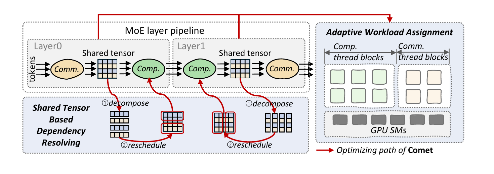
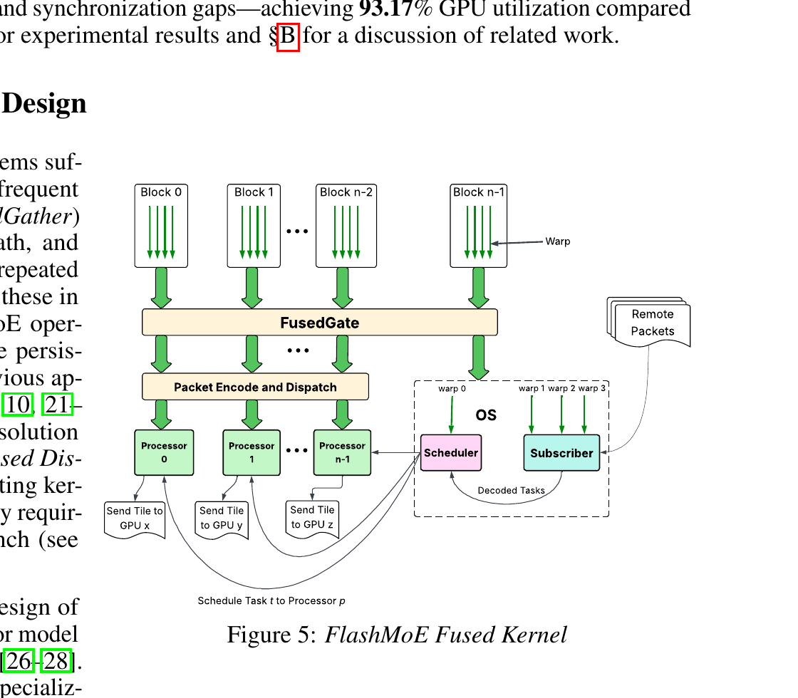
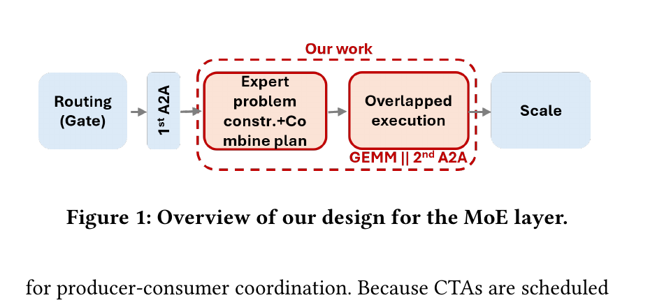
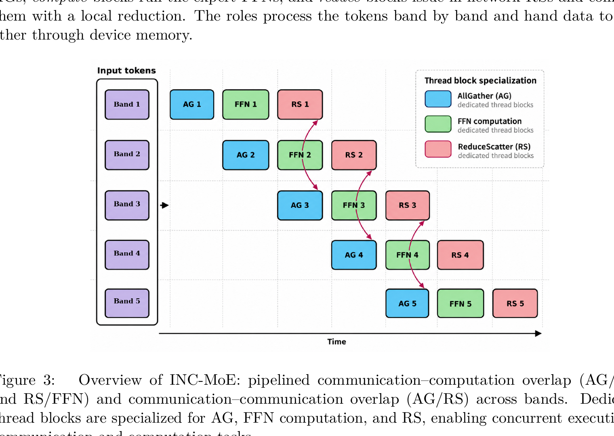
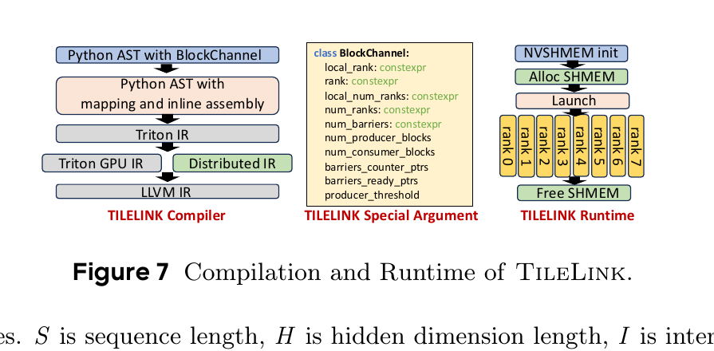

# 融合算子与 Tile 级重叠：逐篇阅读笔记

本目录收录 5 篇 MoE 计算通信融合、细粒度重叠及其编程抽象论文。实验数字与硬件均按原文记录；除非明确写出 NPU，结果均为 NVIDIA GPU 实验。

## 1. Comet: Fine-grained Computation-communication Overlapping for Mixture-of-Experts

**文件**：`COMET_MLSys_2025_2502.19811v3.pdf`；Shulai Zhang 等；MLSys 2025。

### 研究背景与 Motivation

作者用 Megatron-LM 在 8×H800 上分析 Qwen2-MoE、Phi3.5-MoE、Mixtral 8x7B，MoE 的 GPU 间通信在部分模型中占总执行时间最高 47%（Abstract、Fig. 1）。常规按 micro-batch 粗粒度切分 expert GEMM 会损害小 GEMM 利用率，并留下首尾流水气泡；路由导致专家形状动态变化，也使固定通信/计算资源划分难以适用（Sec. 2）。

### 系统 Overview

Fig. 3 的两条 producer-consumer pipeline 通过共享 tensor 交接。Comet 沿依赖切分共享 tensor 并重排执行，再由融合 kernel 自适应分配通信和计算 thread blocks（Sec. 3）。

### Insight → Design

- **通信与计算之间的依赖由共享 tensor 的数据分片决定。** 按对应维度拆分 shared tensor，细化 producer-consumer 依赖，再把不同计算阶段重排，使通信到达和 GEMM 消费形成更紧密的流水（Sec. 3.1、Figs. 4–6）。
- **同形状 tile 并不意味着通信与计算需要相同资源。** 使用 thread-block specialization，让通信与 GEMM 在不同 warp/block 执行；针对输入长度、并行配置预编译多个通信/计算 block 划分，在运行时按 profiling metadata 选用（Sec. 3.2、Figs. 7–8）。
- **融合边界影响同步开销与算力利用。** 对 MoE 两段流水分别设计 kernel，使全局内存访问和通信同步留在 producer-consumer 路径中，并避免用多个 host stream 调度小任务（Sec. 3、4）。

### 实验设计与结果

主测试床为 8×H800、NVLink、CUDA 12.3、NVSHMEM 2.11、PyTorch 2.4 与 Megatron-LM；模型覆盖 Mixtral 8x7B、Qwen2-MoE-2.7B、Phi-3.5-MoE，多种 token 长度和 TP/EP 组合。基线为 Megatron-Cutlass、Megatron-TE、FasterMoE、Tutel；另用 8×L20/PCIe（实测 GPU-GPU 带宽约 25 GB/s）检验带宽受限环境（Sec. 5.1–5.5）。

- Fig. 9：端到端模型延迟相对 Megatron-Cutlass、Megatron-TE、FasterMoE、Tutel 分别降低 **34.1%、42.6%、44.4%、31.8%**。
- Sec. 5.3、Fig. 10：单 MoE layer 对不同基线加速约 **1.28×–2.37×**；特定 layer breakdown 中平均隐藏 **86.5%** 通信时间，计算效率未见相应下降。
- Fig. 14：在 PCIe/L20 带宽受限环境，平均相对其他基线加速 **1.19×–1.46×**。
- Sec. 5.4–5.5：最佳通信/计算 block 划分随 token 数和 TP/EP 配置而变；共享通信 buffer 有随输入规模增长的显存开销（Table 3）。

### 对课题的启发与局限

其依赖图拆分和 task block 配比可以直接转化为性能模型变量：切分粒度、通信 block 数、计算 block 数、shared buffer 占用、依赖气泡。局限是实现依赖 CUDA/NVSHMEM 与 GPU SM/thread-block 机制，实验未覆盖 Ascend 的 AIC/AIV 和多卡 NPU 通信原语。

## 2. FlashMoE: Fast Distributed MoE in a Single Kernel

**文件**：`FlashMoE_NeurIPS_2025_2506.04667v3.pdf`；Osayamen Jonathan Aimuyo 等；NeurIPS 2025。

### 研究背景与 Motivation

远程专家执行会产生 all-to-all、SM 竞争和跨 rank straggler。只重叠独立 kernel 仍需 CPU/stream 协调；让每个 SM 同时负责通信与 GEMM，则可能因 warp 资源和吞吐不平衡导致 GEMM 低效。作者希望把完整 MoE layer 融入单一 persistent kernel，细粒度驱动 token 数据依赖（Sec. 1–2、Figs. 3–4）。

### 系统 Overview

Fig. 5 展示 fused gate/dispatch、processor，以及操作系统式 scheduler/subscriber 如何共同运行单 kernel。Fig. 6 是 DMoE actor 依赖抽象，Fig. 7 是对称张量布局。

### Insight → Design

- **MoE 操作的可运行顺序由 token 到达和专家完成决定。** DMoE task abstraction 将执行写为依赖 actor 链；persistent dispatcher/processor 维护任务队列，communication blocks 观察设备侧 signaling 并将可执行 expert/combine tile 入队（Sec. 3、Fig. 6）。
- **通信和计算不应固定占用相同 SM 资源。** 使用角色分化的 persistent blocks：通信 block 处理单边数据传输与通知，processor blocks 执行 GEMM/Combine。通过适配任务分配响应路由工作量（Sec. 3）。
- **动态 token 数要求远端写入的地址可直接解读。** 对称 tensor layout 配合 in-place padding，避免每轮打包/重排，保存每个 rank 的 token/专家区间元数据（Sec. 3.2、Fig. 7）。
- **设备端调度可能受 straggler 与内存序影响。** 算法使用信号通知和 task bounds 校正，配合 memory consistency 操作，避免过早消费未就绪 token（Appendix implementation）。

### 实验设计与结果

主实验在 NVIDIA A100、与 Megatron-TE/FasterMoE/COMET 等比较前向 latency、GPU 利用率、吞吐、overlap efficiency 和专家数扩展；另含弱扩展、straggler 分析与内存开销（Sec. 4、Figs. 8–12）。论文给出的主要结果是 forward latency 随每 GPU token 数增加仍较稳定，MoE 训练 throughput 和 overlap 高于基线；具体模型大小及指标见各图分组，不把摘要 speedup 混作单一统一配置。实现细节、thread 数、显存开销分别见 Appendix Figs. 13–16、Tables 3–4。

### 对课题的启发与局限

适合参考其“token 到达触发 tile 调度”的执行状态机，并为性能模型增加 queueing、straggler、信号开销和持久 block 的 SM 份额。它基于 NVIDIA GPU/NVSHMEM；单 kernel 依赖设备侧可见队列和访存顺序，不能直接推出 Ascend 算子精度或性能。路由偏斜与动态队列对模型误差的影响值得重点复核。

## 3. Fine-grained Computation-Communication Overlap via Tile-level Signaling and Scheduling for Mixture-of-Experts

**文件**：`Tile_level_signaling_ICPP_2026_2607.19539.pdf`；Minyu Cui 等；ICPP 2026。

### 研究背景与 Motivation

MoE tile 的专家 GEMM 与 token dispatch/combine 存在生产消费依赖。整块 GEMM 完成后才通信会形成粗粒度等待；逐 tile 通知又可能带来大量 signaling 与同步成本。作者将关键问题分成 tile ready 顺序、owner rank 对齐、signal 粒度和 SM 资源切分（Sec. 1–3）。

### 系统 Overview

Fig. 1 展示 token 经 dispatch 到 expert compute、再返回 combine 的流程，以及 tile ready 信号驱动的交叠。Fig. 2（PDF 第 5 页）继续比较 coarse/whole-kernel 与 tile-level overlap 的时间安排。

### Insight → Design

- **remote data 是否可消费取决于 tile 所属目标 rank 与到达时间。** 先以 remote-owner-aligned row layout 组织行，再用 remote-first tile schedule 优先处理远端 expert tile，减少因本地 tile 占用造成的远端依赖空转（Sec. 3.2.1–3.2.2）。
- **signal 粒度越细不一定越快。** 使用 rank-wide persistent GEMM kernel，以 tile-level signaling 表达数据到达；通过通信 granularity 实验选择 tile/row-band 的批量单位，避免每个极小 tile 都付出信号成本（Sec. 3.3、Fig. 3）。
- **通信和 GEMM 对 SM 需求不同。** 以 producer/consumer 专用 kernel 和非阻塞 stream 配置做 SM partition，测量不同划分的 latency，再选择模型/shape 适用配置（Sec. 3.3–3.4）。

### 实验设计与结果

GPU 多卡实验比较端到端模型、单层、算子级、EP 扩展和 SM partition；模型含 M-GPT、M-BERT、M-Trans-xl，基线含 Megatron-CUTLASS、Megatron-TE、Tutel、FasterMoE。另覆盖 4×A100 的 token/rank 负载 sweep、正确性与额外开销分析（Sec. 4.1–4.5、Figs. 4–9）。

- Fig. 4：端到端模型中，相对基线的提升因模型和配置不同；论文总结 M-GPT、M-BERT 的 MoE layer 通常超过 Tutel，M-Trans-xl 相对 Megatron-TE/CUTLASS 的改善较小，因为非 MoE 计算稀释了层内收益。
- Fig. 5–7：单层和 operator-level 的 tile overlap 在高通信负载下更明显；作者报告的算子级相对 FasterMoE 为 **1.23×–1.45×**、相对 Tutel **1.77×–2.16×**（Sec. 4.2.2），MoE layer 的结果按图中配置及 SM 划分解释，避免外推为通用倍率。
- Figs. 8–9：随 EP 和 SM partition 变化，吞吐/延迟不单调，最佳 consumer/producer 配比依赖工作量；Sec. 4.4 检查输出正确性，Sec. 4.5 报告 tile-level signaling 和调度开销。

### 对课题的启发与局限

远端 owner 对齐、tile 到达次序与信号粒度是融合算子关键路径模型中可操作的自变量。可据此分离“通信带宽不足”与“consumer 等数据/调度不足”。该工作仍在 CUDA GPU/stream 上验证；NPU 的事件计数、DMA 完成语义和核间通信机制需替换后再校准。

## 4. INC-MoE: Overlapping In-Network Collectives and Expert Computation for Expert-Parallel MoE Inference

**文件**：`INC_MoE_2610.36339.pdf`；John Stephan 等；arXiv:2610.36339，2026-10-26 预印本。

### 研究背景与 Motivation

MoE 推理 prefill 的 dispatch/combine 通常可分别表达为 AllGather（AG）与 ReduceScatter（RS）。ring collective 把通信流量经过多个 rank，且 AG/RS 串行完成时网络长期占据关键路径。工作研究交换机执行 in-network collective 的情形，能否把通信置于 FFN expert GEMM tile 流水中（Sec. 1–2）。

### 系统 Overview

Fig. 3 展示 AG、FFN 与 RS 的 band pipeline。通信与计算分别按 band/tile 分阶段，角色化 thread blocks 在通信与 GEMM 之间交接（Sec. 3）。

### Insight → Design

- **AG 与 RS 在交换机内可以并行处理，互不占用端点 GPU 的通信执行资源。** 用具 message semantics 的 in-network AG/RS 代替 ring 的多跳传输，并给出由 rank 数、每 rank 带宽和消息大小决定的通信成本表达（Sec. 3.1–3.2、Table 1）。
- **全层通信与计算应按 band 流水，而非等完整 AG/RS。** 设计 band pipeline 与 role-specialized thread blocks：准备的输入 band 满足依赖后启动 expert GEMM；输出 band 再进入 RS，配置项包括 band 数、每 band 工作量及通信/计算 block（Sec. 3.3–3.4）。
- **不规则 dispatch/combine 需要专家计算适配融合布局。** 将 expert computation 融入 overlap kernel 并按路由 metadata 生成工作（Sec. 3.5）。

### 实验设计与结果

原型用四个 GPU accelerator 作为 EP rank，交换机行为由 emulator 模拟；每 rank 受限为 100 Gbps，以与基线公平对比。隔离测试同时 launch AG+RS，端到端比较 vLLM 的 DP=4/EP=4 OLMoE-1B-7B prefill，测 TTFT、每 accelerator 吞吐和等效带宽（Sec. 5.1–5.3、Fig. 5）。

- Sec. 5.2：N=4、100 Gbps 时 ring 并发 AG/RS 的等效带宽上界 133 Gbps，in-network 并行上界 200 Gbps；emulator 测得约 163–172 Gbps（比 ring 的约 130 Gbps 高约 26–32%），尚未达到硬件交换机线速。
- Sec. 5.3、Figs. 1、7：相对 ring AG/RS baseline，TTFT 降低 **20.2%–33.1%**，对应 prefill throughput 增长 **25.3%–49.5%**，范围随每 accelerator prompt token 数从 24K 到 126K 变化。
- 作者指出 emulator 的软件同步开销使小消息结果保守，真实交换机是否达到理论预期仍需硬件验证；论文结果不是 NPU 卡实测。

### 对课题的启发与局限

其 cost model 将通信带宽上界、fill/drain 和 band 数对应到 MoE 层关键路径，可用于融合模型对比 ring/交换机卸载。最关键限制是交换机采用软件 emulator，且 GPU 端仅四个 rank、特定 serving shape；目标课题需测真实 NPU 网络和其 collective/DMA 接口。

## 5. TileLink: Generating Efficient Compute-Communication Overlapping Kernels using Tile-Centric Primitives

**文件**：`TileLink_2503.20313.pdf`；Size Zheng 等；MLSys 2025。

### 研究背景与 Motivation

将通信和计算拆成多个 stream/kernel，容易因 host 同步、过细分块和缓存利用率下降而损失性能；手写融合 kernel 虽快，却需要大量底层编程。融合还要求通信 tile 和计算 tile 使用不同粒度时保持正确的生产者-消费者关系（Sec. 1–2）。

### 系统 Overview

Fig. 7 连接 tile-centric frontend primitives、映射/一致性编译、Triton/Distributed IR 到 PTX 和 NVSHMEM runtime。Fig. 2 定义可分别优化的 tile 大小、tile 顺序与资源映射设计空间。

### Insight → Design

- **通信与计算的优化选择不必绑定。** 分别选择 tile size、tile order、resource mapping；通信可更细来填满 DMA/SM，计算 tile 则保持 GEMM 高效（Sec. 3.1、Fig. 2）。
- **异粒度 producer-consumer 依赖应由抽象原语表达。** 提供 tile signal/data primitives（producer/consumer、peer notify/wait、tile push），将 barrier、地址与数据移动语义交由 backend 处理（Sec. 3.2–3.3）。
- **动态 MoE 路由不能完全静态映射。** 编译期固定可静态求解的 tile/rank/channel 映射；运行时通过 lookup table 填入 dynamic rank 和 shape 信息。编译器保留原语与后续 load/store 的内存依赖，确保 pipeline 重排后语义仍成立（Sec. 4、Fig. 7）。
- **一种融合不适合所有资源。** GEMM+ReduceScatter 中采用 DMA 做 scatter、SM 做 reduce 的 hybrid mapping；AG+MoE 中使 AllGather 与 GroupGEMM tile overlap（Sec. 5、Figs. 4–6）。

### 实验设计与结果

在 8×H800 上测 MLP、MoE、self-attention 单层和端到端模型；基线包括 cuBLAS+NCCL、Async-TP PyTorch、FLUX、vLLM、RingAttention，另测 16×H800 端到端扩展。MoE shape 来自 LLaMA/Gemma/Qwen 类工作负载（Sec. 7.1、Table 4）。

- Fig. 9：MoE 第一段 AG+Gather+GroupGEMM，TileLink 相对 vLLM 平均 **1.51×**；第二段 GroupGEMM+Scatter+TopkReduce+RS，相对 vLLM 平均 **1.31×**；完整 MoE layer 相对 vLLM 平均 **1.14×**，最大相对 cuBLAS+NCCL 为 **20.76×**（不同 shape 的最大值）。
- Fig. 11：8×H800 端到端平均提升 **1.32×**；MoE 模型平均 **1.54×**。16×H800 两节点平均 **1.29×**。
- 编程效率示例中，TileLink 用约 200 行 Python 达到接近 FLUX 的通信/GEMM overlap 实现，FLUX 约 2,000 行 CUDA；这是该示例的代码量对比，并非所有 kernel 的普遍成本（Sec. 2.4、7）。

### 对课题的启发与局限

这是编译器抽象层的直接参考：模型可以显式表示通信/计算不同 tile 尺寸、rank/channel mapping、signal 等待和混合 DMA/计算资源。TileLink 当前只支持 NVIDIA GPU，且系统级跨节点扩展留作未来工作；Ascend 后端和 NPU 设备内存一致性尚未验证。
